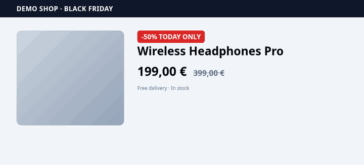

# truediscount

<p align="center"><a href="https://skintoscan.com/#packages"></a><br><sub>If you find this useful, you can support me by getting a SkinToScan pack, my other project. It's a one-time purchase that directly funds my open-source work.</sub></p>
<p align="center"><a href="https://skintoscan.com/checkout/?add-to-cart=138"></a> <a href="https://skintoscan.com/checkout/?add-to-cart=139"></a> <a href="https://skintoscan.com/checkout/?add-to-cart=140"></a></p>

**Is that discount real?** A small browser extension for Chrome and Firefox that checks shop discounts against the lowest price of the last 30 days.

Under the EU Omnibus Directive (2019/2161), a shop announcing a price reduction must use the lowest price of the previous 30 days as the reference "old price". Many Black Friday deals don't. truediscount remembers the prices you see while browsing and tells you, right on the product page, whether the claimed discount holds up.

- 🟢 **Real discount**: the old price matches what we saw in the last 30 days
- 🔴 **Inflated discount**: the shop claims -50%, but the product was cheaper a week ago
- 🟠 **Cheaper recently**: today's price is higher than the 30-day low
- Mini price graph for every tracked product
- 🔔 **Price alerts**: set a target price on the badge and get a browser notification when a visit records a price at or below it
- 💾 **Backup, restore and CSV export**: export your local price history to JSON (for backup/restore) or CSV (for Excel and Google Sheets)



### Works on the first visit

Many EU shops already print their own "lowest price in the last 30 days" next to a sale. truediscount reads that disclosure (in English, German, French, Italian, Spanish, Dutch, Polish, Romanian, Czech, Croatian and more) and compares it with the crossed-out price, so you get a verdict before any history has been recorded.


### Price alerts

Click **Alert me below** on the badge (10% under today's price by default, editable). Watched products are listed first in the popup, and the toolbar icon shows how many are at or below their target. Prices are checked whenever you open the product page; the extension never loads shop pages in the background.

### Backup and restore

Open the popup and click **Backup / restore** to see a full table of your tracked products, 30-day lows and active alerts. **Export JSON** saves a `truediscount-history-YYYY-MM-DD.json` file; **Export CSV** saves a spreadsheet-ready `.csv` of every tracked product (latest price, 30-day low, 90-day min/max, alert target and dates); **Import history** loads a JSON backup, for example on a new computer or in a second browser. Imports are validated and merged with what is already stored: one price per product per day (the lowest wins), last 90 days only. Your local names and alerts are kept. Nothing leaves your computer unless you move the file.

## Install in 60 seconds

truediscount is not in the browser stores yet, so you load it yourself. It takes about a minute.

**Chrome, Edge, Brave, Opera, Vivaldi**
1. Download `truediscount-chrome-<version>.zip` from the [latest release](https://github.com/emirmrkaljevic/truediscount/releases/latest) and unzip it.
2. Open `chrome://extensions` (Edge: `edge://extensions`, Brave: `brave://extensions`).
3. Turn on **Developer mode** (top right; in Edge it is in the left sidebar).
4. Click **Load unpacked** and select the unzipped folder.
5. Pin the truediscount icon from the puzzle-piece menu and open any product page on a supported shop.

Keep the folder where it is: the browser loads the extension from it. To update, unzip the new version over it and click the reload icon on the extension card.

**Firefox**
1. Download `truediscount-firefox-<version>.zip` from the [latest release](https://github.com/emirmrkaljevic/truediscount/releases/latest) (no need to unzip).
2. Open `about:debugging#/runtime/this-firefox`.
3. Click **Load Temporary Add-on…** and select the zip.

Temporary add-ons are removed when Firefox restarts. A signed version on addons.mozilla.org is on the way. Until then, Firefox Developer Edition, Nightly and ESR can keep it installed: set `xpinstall.signatures.required` to `false` in `about:config`, then install the zip from `about:addons` → gear menu → **Install Add-on From File**. Requires Firefox 140 or newer (Firefox for Android 142 or newer).

## Privacy

Local-first. Prices are stored only in your browser (`storage.local`). No account, no analytics, no network requests, no personal data. Clear everything from the popup at any time, or export it to a file you control.

## Languages

English and German. The extension follows your browser language. Translations are in `_locales/<lang>/messages.json`; pull requests for more EU languages are welcome.

## Supported shops

Built-in (MediaMarkt, Zalando, Coolblue and Alternate checked against live product pages in October 2026): Amazon (DE, FR, IT, ES, NL, PL, SE, BE), Zalando, MediaMarkt / Saturn, Otto, eMAG, Allegro, bol.com, Coolblue (NL, BE, DE), Alternate (DE, NL, BE, AT). Full table with test status: [Supported shops](https://emirmrkaljevic.github.io/truediscount/supported-shops.html).

Badge missing or wrong? Click **Report a problem** in the popup. It opens a prefilled GitHub issue with just the shop's domain and what was detected, so you can add a product link and submit it.

Any other shop: open the popup and click **Enable on this site**. Works on pages with schema.org `Product` data (JSON-LD, including `StrikethroughPrice` / `ListPrice`), Open Graph price tags, strike-through markup, or labelled reference prices such as "statt", "UVP", "van", "przed obniżką" or "PRP".

## Limitations

When a shop crosses out the manufacturer's recommended retail price (RRP/UVP) rather than its own earlier price, the badge says so: RRP comparisons are not covered by the 30-day rule.

Your own history starts when you first visit a product. Until then the verdict relies on the shop's 30-day disclosure, when there is one. The verdict is informational and based only on prices seen in your browser; it is not a legal assessment.

## Development

```sh
npm install
npm test        # unit tests on HTML fixtures
npm run build   # dist/truediscount-chrome-<v>.zip and dist/truediscount-firefox-<v>.zip
```

To try a local build, follow [Install in 60 seconds](#install-in-60-seconds) with the zips from `dist/`.

Adding a shop: add an adapter to `src/core/extract.js`, its host to `src/hosts.js`, and a fixture test.

## Website

Website: https://emirmrkaljevic.github.io/truediscount/

Read more: [Catching fake Black Friday discounts with a 400-line browser extension (and the EU's 30-day rule)](https://dev.to/emirmrkaljevic/catching-fake-black-friday-discounts-with-a-400-line-browser-extension-and-the-eus-30-day-rule-541e) on DEV.

truediscount is free and open source (MIT). A Pro version with price-drop alerts, longer history and export is planned.
