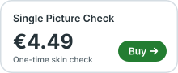
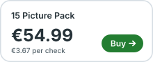
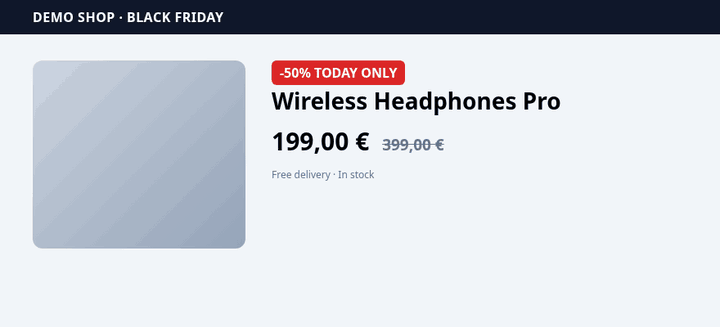

# truediscount

 If you find this useful, you can support me by getting a SkinToScan pack, my other project. It's a one-time purchase that directly funds my open-source work.

  

truediscount is a free, open-source browser extension for Firefox, Chrome and Edge. On an EU product page it checks the claimed discount against the 30-day lowest price that shops must use under the EU Omnibus rule. I built it so you can see, on the page itself, whether a sale is a real price drop or an inflated percentage.

It runs out of the box on Amazon EU, Zalando, MediaMarkt and the other shops in the [supported shops](docs/supported-shops.md) list. Prices stay in your browser; there is no account and no data is sent anywhere. You can try the same verdicts in the [live demo](https://emirmrkaljevic.github.io/truediscount/#demo) without installing.

## Install

**Firefox:** [Install for Firefox](https://addons.mozilla.org/en-US/firefox/addon/truediscount/) from addons.mozilla.org. It updates automatically.

A Chrome Web Store listing is coming later. Until then, Chrome-based browsers load the zip, or you can use the userscript.

**Chrome, Edge, Brave, Opera, Vivaldi**
1. Download `truediscount-chrome-<version>.zip` from the [latest release](https://github.com/emirmrkaljevic/truediscount/releases/latest) and unzip it.
2. Open `chrome://extensions` (Edge: `edge://extensions`, Brave: `brave://extensions`).
3. Turn on **Developer mode** (top right; in Edge it is in the left sidebar).
4. Click **Load unpacked** and select the unzipped folder.
5. Pin the truediscount icon from the puzzle-piece menu and open a product page on a supported shop.

Keep the folder where it is: the browser loads the extension from it. To update, unzip the new version over it and click the reload icon on the extension card.

**Userscript (Tampermonkey, Violentmonkey)**
1. Install [Tampermonkey](https://www.tampermonkey.net/) or [Violentmonkey](https://violentmonkey.github.io/).
2. Open [truediscount.user.js](https://github.com/emirmrkaljevic/truediscount/releases/latest/download/truediscount.user.js) from the [latest release](https://github.com/emirmrkaljevic/truediscount/releases/latest) and click Install. It is also on [Greasy Fork](https://greasyfork.org/en/scripts/602599).

Temporary or unsigned Firefox sideloading is described in [Development](docs/development.md).

## Example

Open a product page on a supported shop. The badge next to the price tells you whether the claimed discount matches the 30-day low:

- **Real discount**: the old price matches the 30-day low
- **Inflated discount**: the shop claims -50%, but the product was cheaper recently
- **Cheaper recently**: today's price is higher than the 30-day low

Many EU shops already print their own "lowest price in the last 30 days". The extension reads that label (English, German, French, Italian, Spanish, Dutch, Polish and more) and can give a verdict on the first visit.

The popup also keeps a mini price graph, price alerts, a watchlist and a local JSON/CSV backup. You can hide the badge on any site, or click **Enable on this site** on a shop that is not built in. If the badge is missing or wrong, **Report a problem** opens a prefilled GitHub issue with just the shop's domain.

## Limitations

When a shop crosses out the manufacturer's recommended retail price (RRP/UVP) rather than its own earlier price, the badge says so. That comparison is not covered by the 30-day rule.

Your own history starts when you first visit a product. Until then the verdict uses the shop's 30-day disclosure, when there is one. The verdict is informational and based only on prices seen in your browser; it is not a legal assessment.

Prices are stored only in your browser. You can clear everything from the popup, or export it to a file you control. The full note is in [PRIVACY.md](PRIVACY.md).

## Docs

- [Supported shops](docs/supported-shops.md) (also on the [website](https://emirmrkaljevic.github.io/truediscount/supported-shops.html))
- [The EU 30-day lowest price rule](docs/omnibus.md)
- [Development](docs/development.md)
- [Privacy](PRIVACY.md)
- [Changelog](CHANGELOG.md)
- Website: https://emirmrkaljevic.github.io/truediscount/
- How I built it: [Catching fake Black Friday discounts with a 400-line browser extension (and the EU's 30-day rule)](https://dev.to/emirmrkaljevic/catching-fake-black-friday-discounts-with-a-400-line-browser-extension-and-the-eus-30-day-rule-541e) on DEV

## License

MIT. The interface is English and German (it follows your browser language; translations welcome in `_locales/`).
