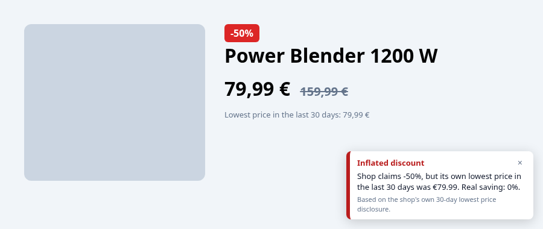
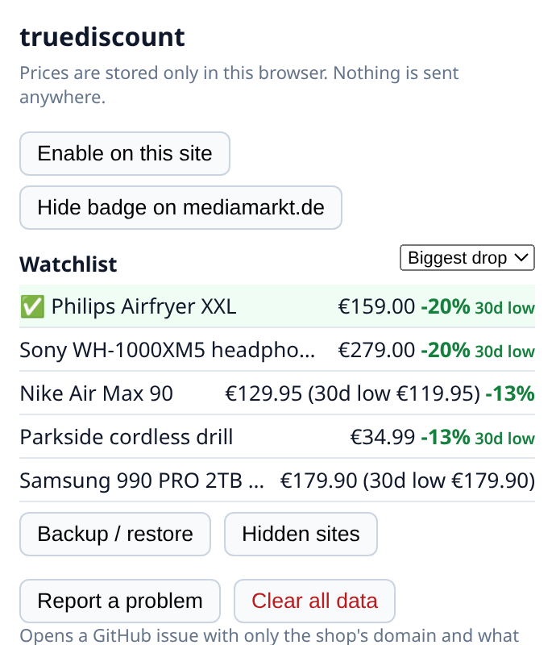

# The EU 30-day lowest price rule

Under the EU Omnibus Directive (2019/2161), a shop announcing a price reduction must use the lowest price of the previous 30 days as the reference "old price". Many Black Friday deals don't. truediscount remembers the prices you see while browsing and tells you, right on the product page, whether the claimed discount holds up.

A longer country-by-country guide lives on the website: [The EU 30-day lowest price rule](eu-30-day-lowest-price-rule.html). Related pages: [How to check if a Black Friday discount is real](black-friday-discount-check.html), [Fake discount tricks](guides/fake-discount-tricks.html), [Fake discount fines in the EU](guides/omnibus-enforcement-cases.html), [Report a fake discount](guides/report-a-fake-discount.html).

## Works on the first visit

Many EU shops already print their own "lowest price in the last 30 days" next to a sale. truediscount reads that disclosure (in English, German, French, Italian, Spanish, Dutch, Polish, Romanian, Czech, Croatian and more) and compares it with the crossed-out price, so you get a verdict before any history has been recorded.

## Price alerts

Click **Alert me below** on the badge (10% under today's price by default, editable). Watched products are listed first in the popup, and the toolbar icon shows how many are at or below their target. Prices are checked whenever you open the product page; the extension never loads shop pages in the background.

## Watchlist

The popup shows every product you have visited, with the latest price you saw, the 30-day low and how far the price is below its 30-day high. Switch the list to **Biggest drop** to see which items on your Black Friday wishlist really got cheaper, and click a product to open its page. Prices on this list only update when you visit the product page.

## Backup and restore

Open the popup and click **Backup / restore** to see a full table of your tracked products, 30-day lows and active alerts. **Export JSON** saves a `truediscount-history-YYYY-MM-DD.json` file; **Export CSV** saves a spreadsheet-ready `.csv` of every tracked product (latest price, 30-day low, 90-day min/max, alert target and dates); **Import history** loads a JSON backup, for example on a new computer or in a second browser. Imports are validated and merged with what is already stored: one price per product per day (the lowest wins), last 90 days only. Your local names and alerts are kept. Nothing leaves your computer unless you move the file.

## Limitations

When a shop crosses out the manufacturer's recommended retail price (RRP/UVP) rather than its own earlier price, the badge says so: RRP comparisons are not covered by the 30-day rule.

Your own history starts when you first visit a product. Until then the verdict relies on the shop's 30-day disclosure, when there is one. The verdict is informational and based only on prices seen in your browser; it is not a legal assessment.

A Pro version with price-drop alerts, longer history and export is planned. The current free version already includes alerts, a 90-day local history, and JSON/CSV export.

Back to the [README](../README.md).
